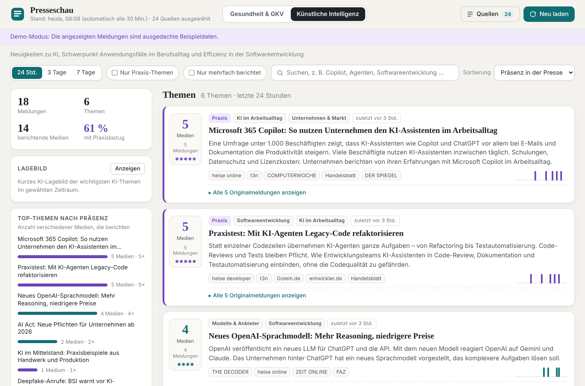

# Presseschau – News-Dashboard

Web-Dashboard, das Meldungen deutscher Medien zu mehreren **Themenbereichen** sammelt, ähnliche Meldungen zu Themen bündelt und zeigt, **wie viele Medien** über ein Thema berichten. Jede Themengruppe enthält die Links zu allen Originalmeldungen und eine Zusammenfassung.

| Themenbereich | Schwerpunkt (Fokus) |
|---|---|
| **Gesundheit & GKV** | Gesundheitsbranche, besonderes Augenmerk auf die **gesetzliche Krankenversicherung** |
| **Künstliche Intelligenz** | **Praxis:** Anwendungsfälle für KI im beruflichen Alltag und Möglichkeiten für Softwareentwicklungsfirmen, ihre Effizienz zu steigern |

Umgeschaltet wird über die Reiter oben im Dashboard; ein Bereich lässt sich auch direkt verlinken (`…/#ki`, `…/#gesundheit`).



## Funktionen

- **Quellen-Dialog je Themenbereich:** rund 60 deutsche Medien, je Bereich passend gruppiert – Leitmedien, Wirtschaft und Öffentlich-rechtliche für beide; dazu Fachmedien Gesundheit und Politik/Selbstverwaltung/Kassen für GKV sowie Tech- & IT-Medien (heise, Golem, t3n, COMPUTERWOCHE …), KI-Fachmedien (THE DECODER …), Softwareentwicklung (heise developer, iX, entwickler.de) und Politik/Verbände/Forschung (Bitkom, Digitalministerium, Mittelstand-Digital …) für KI. Die Auswahl wird je Bereich gespeichert; der Status des letzten Abrufs ist sichtbar. Eigene Quellen lassen sich ergänzen (lokaler Betrieb).
- **Themenfilter mit Fokus:** Eine gewichtete Stichwortbewertung je Bereich filtert relevante Meldungen heraus und markiert den Fokus gesondert:
  - Gesundheit: ≈150 Begriffe von *Zusatzbeitrag* über *Krankenhausreform* bis *E-Rezept*; Fokus **GKV**.
  - KI: ≈200 Begriffe von *Sprachmodell* über *Copilot* bis *Code-Review*; Fokus **Praxis** mit den Themenfeldern *KI im Arbeitsalltag* und *Softwareentwicklung*. Allgemeine Nachrichten brauchen einen eindeutigen KI-Begriff, damit z. B. „Mittelstand steigert Effizienz“ ohne KI-Bezug nicht auftaucht.
- **Clustering:** Ähnliche Meldungen werden per TF-IDF und Average-Linkage-Clustering zu Themen gruppiert (Komposita wie *Krankenkassenbeiträge* werden berücksichtigt). Die Schärfe ist in den Einstellungen regelbar.
- **Präsenz in der Presse:** Jede Themenkarte zeigt die Zahl der berichtenden Medien, die Zahl der Meldungen und einen Zeitverlauf. Eine Seitenleiste zeigt die Top-Themen als Balken und die Verteilung auf Themenfelder.
- **Zusammenfassungen:**
  - ohne KI: die zentralsten Sätze aus den Teasern (extraktiv, kostenlos, offline),
  - mit KI (optional): Überschrift, 2–4 Sätze Zusammenfassung und eine Einschätzung zum Fokus – **GKV-Relevanz** bzw. **Praxisnutzen** (konkrete Anwendungsfälle im Berufsalltag oder Effizienzpotenziale für die Softwareentwicklung) – über Anthropic Claude, OpenAI oder ein lokales Ollama-Modell. Dazu ein **Lagebild** je Bereich; im KI-Bereich mit Ideen „Zum Ausprobieren“.
- **Zeitraum** 24 Stunden / 3 Tage / 7 Tage, Filter „Nur GKV-Themen“ bzw. „Nur Praxis-Themen“ und „Nur mehrfach berichtet“, Filter nach Themenfeld, Volltextsuche, Sortierung.
- **Automatische Aktualisierung** alle 15 Minuten; Meldungen werden 8 Tage lokal vorgehalten, damit auch die 7-Tage-Sicht vollständig ist.
- **Keine Abhängigkeiten:** reines Node.js, kein `npm install` nötig. Heller und dunkler Modus, mobil nutzbar.

## Nutzung ohne eigenen Server (GitHub Pages) – empfohlen

Du brauchst nichts zu installieren: GitHub ruft die Feeds alle 30 Minuten automatisch ab und veröffentlicht das Dashboard als Webseite.

1. Im Repository **Settings → Pages** öffnen und unter *Build and deployment → Source* **GitHub Actions** auswählen.
2. Unter **Actions** den Workflow *Dashboard aktualisieren* öffnen und **Run workflow** klicken (danach läuft er alle 30 Minuten von selbst).
3. Nach 1–2 Minuten ist das Dashboard erreichbar unter
   **https://v9zd9h4g2k-cmd.github.io/gesundheits-news-dashboard/**

Die Quellenauswahl im Dialog wird in deinem Browser gespeichert.

**KI-Zusammenfassungen (optional):** unter **Settings → Secrets and variables → Actions → New repository secret** einen Key als `ANTHROPIC_API_KEY` (oder `OPENAI_API_KEY`) anlegen. Ab dem nächsten Lauf gibt es KI-Zusammenfassungen, GKV- bzw. Praxis-Einschätzungen und das Lagebild für beide Bereiche. Ein anderes Modell lässt sich als Variable `LLM_MODEL` (Reiter *Variables*) festlegen. Pro Lauf werden höchstens 80 neue Zusammenfassungen erzeugt (je Bereich 40); bereits erstellte werden wiederverwendet. Die Obergrenze lässt sich über die Variable `MAX_AI_PER_RUN` ändern.

Hinweise:
- Die Seite ist öffentlich erreichbar (wie das Repository). Sie enthält nur Titel, Teaser und Links öffentlicher Feeds; der API-Key bleibt als Secret verborgen.
- GitHub pausiert zeitgesteuerte Workflows, wenn im Repository 60 Tage lang nichts passiert. Dann unter *Actions* einmal auf *Enable workflow* klicken.
- Zeitgesteuerte Läufe können sich bei hoher Auslastung von GitHub um einige Minuten verzögern.

## Lokaler Betrieb (optional)

Voraussetzung: [Node.js](https://nodejs.org) ab Version 18 (empfohlen 20 oder 22).

```bash
git clone https://github.com/v9zd9h4g2k-cmd/gesundheits-news-dashboard.git
cd gesundheits-news-dashboard
npm start
```

Dann im Browser **http://localhost:3000** öffnen. Beim ersten Start werden die Feeds abgerufen (dauert einige Sekunden).

Nur ausprobieren, ohne Internetzugriff: `npm run demo` – startet mit ausgedachten Beispieldaten.

## KI-Zusammenfassungen einrichten (optional)

Entweder im Dashboard über das Zahnrad (⚙) → *KI-Zusammenfassung*: Anbieter wählen und API-Key eintragen. Der Key wird nur lokal in `data/settings.json` gespeichert.

Oder per `.env`-Datei:

```bash
cp .env.example .env
# dann in .env eintragen, z. B.:
ANTHROPIC_API_KEY=sk-ant-...
```

| Anbieter | Standardmodell | Hinweis |
|---|---|---|
| Anthropic Claude | `claude-haiku-4-5-20251001` | schnell und günstig; Modell über `LLM_MODEL` oder im Dialog änderbar |
| OpenAI | `gpt-4.1-mini` | Modellname ggf. an dein Konto anpassen |
| Ollama (lokal) | `llama3.1` | läuft komplett auf deinem Rechner, `ollama pull llama3.1` vorher |

Zusammenfassungen werden je Themengruppe zwischengespeichert (`data/summaries.json`) und nur neu erzeugt, wenn neue Meldungen hinzukommen. Es werden nur die gerade sichtbaren Themen zusammengefasst.

## Konfiguration

| Variable | Standard | Bedeutung |
|---|---|---|
| `PORT` | `3000` | Port des Webservers |
| `HOST` | `127.0.0.1` | `0.0.0.0` macht das Dashboard im Heimnetz erreichbar |
| `REFRESH_MINUTES` | `15` | Intervall für den automatischen Feed-Abruf |
| `LLM_PROVIDER` | `auto` | `auto`, `anthropic`, `openai`, `ollama`, `none` |
| `LLM_MODEL` | – | überschreibt das Standardmodell |
| `DATA_DIR` | `./data` | Speicherort für Einstellungen, Artikel und Zusammenfassungen |

## Quellen und Feeds

Die Standardquellen stehen in [`src/sources.js`](src/sources.js); dort ist je Quelle festgelegt, in welchen Themenbereichen sie auswählbar und vorausgewählt ist. Für Medien ohne passenden RSS-Feed (z. B. GKV-Spitzenverband, Bitkom, CIO) sucht die **Google-News-Ergänzung** gezielt nach Artikeln der jeweiligen Domain – mit den Suchbegriffen des jeweiligen Themenbereichs. Sie ist standardmäßig aktiv und lässt sich im Quellen-Dialog abschalten (lokaler Betrieb).

Medien ändern ihre Feed-Adressen gelegentlich. Mit

```bash
npm run check-feeds             # alle RSS-Feeds prüfen
npm run check-feeds -- --google # zusätzlich die Google-News-Suche
```

siehst du, welche Feeds erreichbar sind. Nicht erreichbare Feeds werden im Quellen-Dialog rot markiert und im Protokoll jedes GitHub-Laufs (Schritt *Feeds abrufen und Seite bauen*) aufgelistet; eine korrigierte Adresse kannst du in `src/sources.js` eintragen.

## Weiteren Themenbereich ergänzen

1. `src/topics/gesundheit.js` oder `src/topics/ki.js` als Vorlage kopieren, z. B. nach `src/topics/energie.js`, und anpassen: Name, Fokus, Themenfelder, Stichwortregeln, Google-News-Suchbegriffe, Quellengruppen und KI-Prompts.
2. Das neue Thema in `src/topics/index.js` in die Liste `TOPICS` aufnehmen.
3. In `src/sources.js` bei passenden Quellen die Themen-ID unter `topics` (und ggf. `defaults`) ergänzen bzw. neue Quellen anlegen.
4. `npm test` ausführen – die Tests prüfen u. a., ob alle Quellen gültigen Themen und Gruppen zugeordnet sind.

## So funktioniert es

```
RSS/Atom-Feeds + Google-News-Suche  →  Speicher (8 Tage, data/articles.json)
        →  je Themenbereich: Relevanz + Fokus (src/relevance.js, Regeln in src/topics/)
        →  je Themenbereich: Clustering ähnlicher Meldungen (src/cluster.js)
        →  Zusammenfassung: extraktiv oder KI (src/summarize.js)
        →  Dashboard im Browser (public/)
```

- **Relevanz:** Treffer im Titel zählen doppelt. Für Fach-Rubriken eines Themas (z. B. Ärzteblatt, THE DECODER, heise KI) genügt ein schwächerer Bezug als für allgemeine Nachrichten-Feeds. Eine Meldung kann in beiden Bereichen erscheinen (z. B. „KI im Krankenhaus“).
- **Präsenz:** Sortiert wird nach `3 × Anzahl Medien + Anzahl Meldungen` (+ Bonus für Fokus-Bezug) – ein Thema, über das viele verschiedene Medien berichten, steht oben.
- **Gruppierung im KI-Bereich:** Wörter, die in fast jeder KI-Meldung stehen („KI“, „Künstliche Intelligenz“), werden beim Gruppieren ignoriert; Synonyme wie *AI Act* / *KI-Verordnung* werden zusammengeführt.
- **Duplikate:** Dieselbe Meldung aus RSS und Google News wird zusammengeführt; Tracking-Parameter werden aus Links entfernt.

## Projektstruktur

```
.github/workflows/pages.yml  automatischer Abruf und Veröffentlichung auf GitHub Pages
scripts/build-static.js      erzeugt die statische Seite (npm run build)
```

```
server.js            HTTP-Server und API
src/topics/          Themenbereiche: Stichwortregeln, Fokus, Quellengruppen, KI-Prompts
src/sources.js       Standardquellen und Feeds (mit Zuordnung zu Themenbereichen)
src/feeds.js         Abruf und Parsing von RSS/Atom (ohne Bibliotheken)
src/relevance.js     Stichwortbewertung je Themenbereich
src/cluster.js       TF-IDF, Clustering, extraktive Zusammenfassung
src/summarize.js     KI-Anbindung (Anthropic, OpenAI, Ollama) mit Cache
src/news.js          Abruf-Steuerung, Speicher, Auswertung
src/demo-data.js     Beispieldaten für npm run demo
public/              Oberfläche (HTML, CSS, JavaScript)
scripts/check-feeds.js  Feed-Prüfung
test/                Tests (npm test)
```

## Hinweise

- Das Dashboard zeigt nur Titel, Teaser und Links aus den öffentlichen Feeds; die vollständigen Artikel liegen bei den Medien (teils hinter Bezahlschranken).
- Alle Daten bleiben lokal im Ordner `data/` (von Git ausgeschlossen).
- Die KI-Zusammenfassungen basieren auf den Teasern der Meldungen und können Fehler enthalten – im Zweifel die Originalmeldung lesen.
